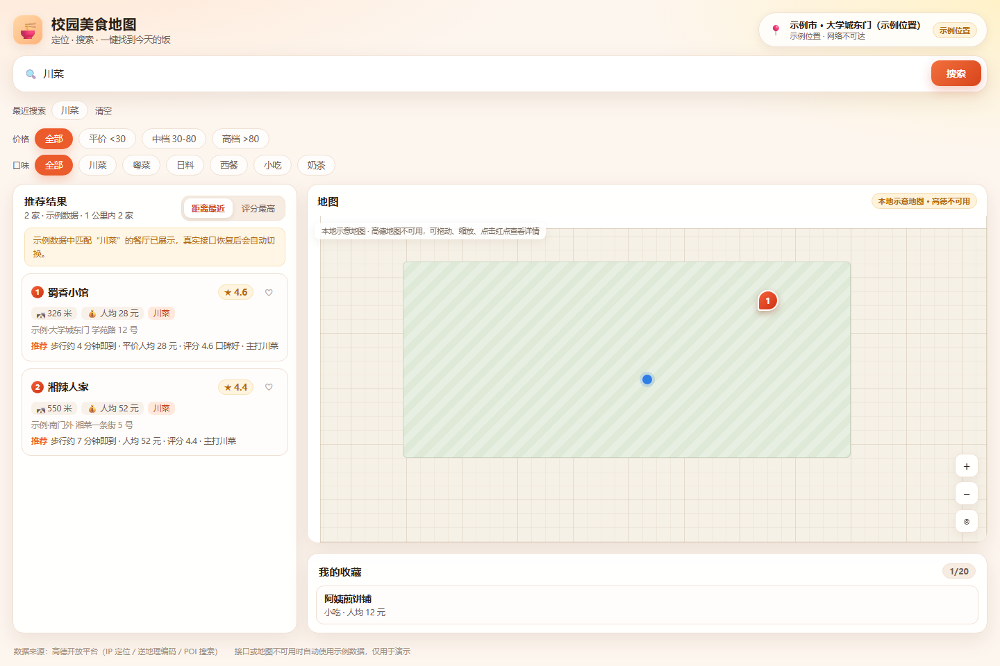
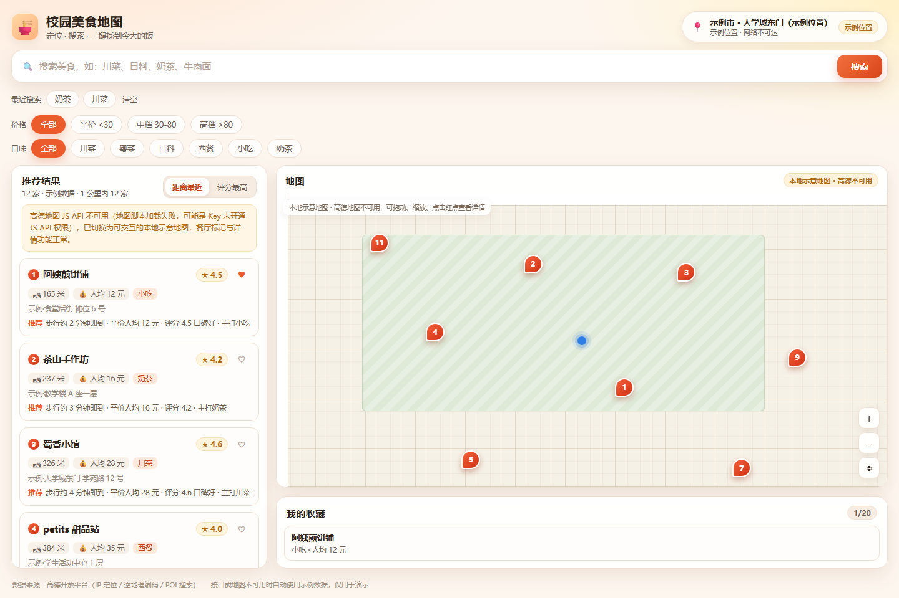
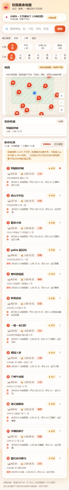

# 校园美食助手 SDD 实验

实验 7-2：SDD 规范驱动开发。项目从实验 7-1 的校园美食助手出发，通过 CodeArts Agent 的规范驱动模式新增“餐厅收藏”和“最近搜索”，并补充数据校验、XSS 防护和代码规范约束。

## 功能

- IP 定位、逆地理编码和校园周边 POI 搜索。
- 餐厅列表、距离/评分排序、价格/口味组合筛选和步行路线。
- 餐厅收藏：卡片收藏按钮、`localStorage` 持久化、20 家上限、“我的收藏”面板和地图联动。
- 最近搜索：最多 8 项、最近优先、关键词去重、`localStorage` 持久化、点击复用和整体清空。
- 安全与规范：餐厅 ID 校验、XSS 过滤、ES6、JSDoc、camelCase、`addEventListener`。
- 高德地图 JS API 不可用时自动使用可交互的本地示意地图。

## 运行

```powershell
cd D:\xuexiziliao\ai\lab7-sdd-campus-food
python -m http.server 8768
```

浏览器打开 <http://127.0.0.1:8768/>。

## 本地 Key

真实 Key 只保存在被忽略的本地文件中：

- `config.local.js`
- `.codeartsdoer/mcp/mcp_settings.json`

仓库只提交 [config.example.js](config.example.js) 和 [mcp_settings.example.json](mcp_settings.example.json)。不要把真实 Key 写入 HTML、CSS、JS 示例、README 或截图。

## SDD 文档

### 餐厅收藏

- [需求规格](specs/restaurant-favorites/spec.md)
- [实现方案](specs/restaurant-favorites/design.md)
- [编码任务](specs/restaurant-favorites/tasks.md)

### 最近搜索

- [需求规格](specs/recent-search/spec.md)
- [实现方案](specs/recent-search/design.md)
- [编码任务](specs/recent-search/tasks.md)

CodeArts 实际使用的项目级规格归档位于 `.codeartsdoer/specs/`，其中 `restaurant-favorites` 和 `recent-search` 使用连字符命名。

## 三轮交付过程

### 1. 无规格对照

先用不写规格的方式要求增加收藏功能，记录 AI 自行补全需求后出现的语义缺口。该方案未进入代码实现。

提示词与记录：

- [无规格提示词](prompts/01-vague-favorites.md)
- [无规格结果截图](evidence/screenshots/01-vibe-vague-spec.png)

### 2. 正式 SDD 功能实现

通过 CodeArts 规范驱动模式依次生成需求、设计和任务，然后实现收藏与最近搜索。

- [收藏功能提示词](prompts/02-favorites-sdd.md)
- [最近搜索提示词](prompts/03-recent-search-sdd.md)
- [SDD 完成记录](evidence/screenshots/02-codearts-sdd-complete.png)



### 3. 规范约束增强

在功能通过验收后，为规格补充 ID 校验、XSS 防护、ES6、JSDoc、camelCase 和 `addEventListener` 约束，并重新生成代码。

- [约束增强提示词](prompts/04-constraints-sdd.md)
- [规范对比](evidence/spec-comparison.md)

## 最终运行效果

桌面端：



移动端：



## 验收结果

| 验收项 | 结果 |
|---|---|
| 默认餐厅和收藏按钮 | 12 / 12 |
| 收藏后刷新 | 状态和计数保持 |
| 收藏上限 | 第 21 家被阻止并提示 |
| 收藏项联动地图 | 卡片选中、信息窗可见 |
| 最近搜索持久化 | 刷新后保留 |
| 最近搜索上限 | 8 项 |
| 最近搜索清空 | 区域隐藏、toast 正确 |
| 无效餐厅 ID | 不执行操作并 `console.warn` |
| XSS 注入 | 未执行脚本、无注入节点 |
| ES6 / JSDoc | `var=0`，JSDoc 覆盖业务函数 |
| inline onclick | 0 |
| 移动端 390px | 无横向溢出 |
| 页面脚本异常 | 0 |

完整结果见 [验收报告](evidence/test-report.md) 和 [CodeArts 使用记录](evidence/codearts-usage.md)。

## 目录

```text
.
├─ index.html
├─ styles.css
├─ app.js
├─ mock-data.js
├─ config.example.js
├─ mcp_settings.example.json
├─ prompts/
├─ specs/
├─ skills/
└─ evidence/
   ├─ screenshots/
   └─ logs/
```

