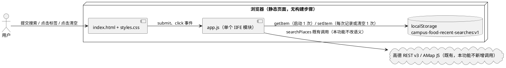
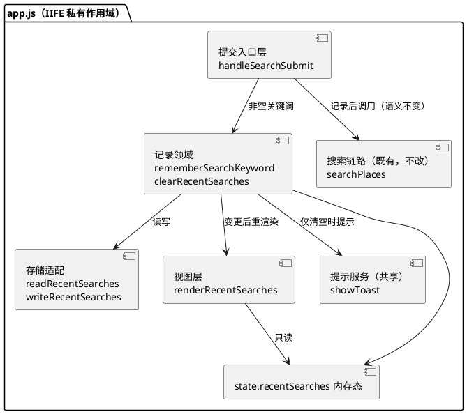
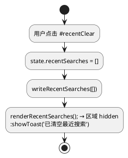
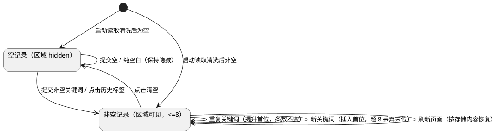
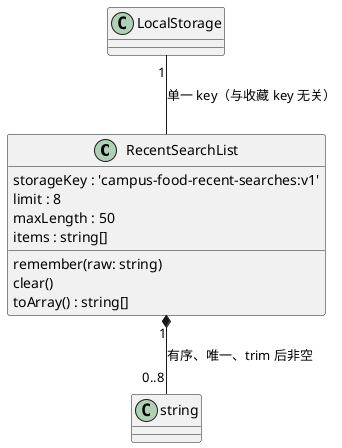
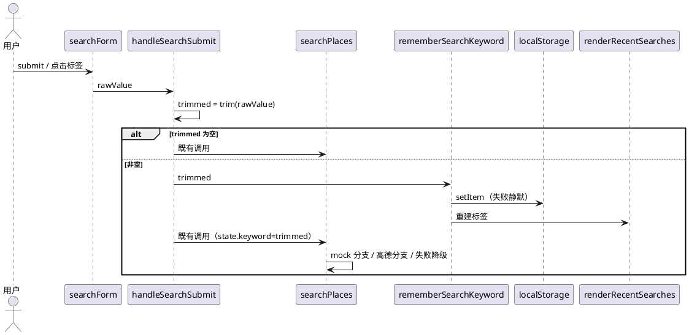

# 最近搜索 · 实现方案设计（design）

> 文档定位：把 `.codeartsdoer/specs/recent-search/spec.md` 转化为对既有代码的最小增量方案。
> 需求基线：`spec.md`（唯一验收依据）。本功能无既定 `tasks.md`，本文档只给设计与契约，不产出任务分解。
> 技术约束：零依赖原生实现（纯 HTML/CSS/JS，沿用 `fetch` 访问高德 REST）；分离式手写 `styles.css`（桌面左右分栏、移动堆叠）；文件名小写 kebab-case；代码标识符英文；**不新增后端接口、不新增任何网络请求**（纯本地能力）。
> 改动范围：仅 `index.html`、`styles.css`、`app.js` 三个既有文件。

---

# 一、需求与存量功能关系分析

## 1.1 需求功能与存量功能对比

### 1.1.1 已实现功能

| 需求功能 | 存量功能 | 代码位置 | 匹配度 |
| --- | --- | --- | --- |
| 提交时机（点击"搜索"或回车） | `searchForm` 的 `submit` 监听，`preventDefault` 后 `state.keyword = dom.searchInput.value.trim()` 并 `searchPlaces()` | `app.js:115-119` | 100%（唯一且完整的提交入口，可直接作为记录锚点） |
| 关键词状态载体 | `state.keyword` | `app.js:24` | 100% |
| 搜索执行（高德 REST / 示例数据） | `searchPlaces(options)` | `app.js:451-486` | 100%（作为被调用方保持不变，语义零改动） |
| 初始自动搜索 | `locateAndSearch()` → `searchPlaces({ initial: true })` | `app.js:384-414`（调用在 410） | 100%（该路径不经过 submit，天然不产生记录） |
| 筛选/排序事件 | `dom.filterBar` 点击委托（价格/口味）、`setSort()` | `app.js:121-135`、`240-250` | 100%（与提交路径物理隔离，天然满足"筛选不记录"） |
| 搜索框 DOM | `#searchForm` / `#searchInput`（`type="search"`）/ `#searchBtn` | `index.html:30-34` | 100% |
| 首页纵向区块布局 | `.app-header` 为纵向 flex（品牌/位置 → 搜索栏 → 筛选栏） | `styles.css:39-44` | 100%（新增区块插在搜索栏与筛选栏之间即可） |
| 文本转义 | `esc(value)` | `app.js:1186-1190` | 100% |
| 轻量标签视觉 | `.chip` / `.chip:hover` / `.chip.is-active` | `styles.css:171-189` | 75%（视觉可借鉴，但类名须独立，避免与 `.filterBar` 内筛选 chip 语义混淆） |
| 空态/显隐控制 | `[hidden] { display: none !important; }` | `styles.css:630` | 100%（隐藏区域时零占位，满足"无布局跳动"） |
| 提示条 | `note()` / `clearNote()`（页内常驻 `.notice`） | `app.js:258-268`、`styles.css:251-260` | 25%（常驻、无自动消失、无浮层，不能承载"已清空最近搜索"的一次性 toast） |
| 本地存储 | 无任何 `localStorage` 使用 | — | 0%（全量新增，需自建 key） |

### 1.1.2 需要扩展的功能

| 需求功能 | 存量功能 | 差异说明 | 扩展方向 |
| --- | --- | --- | --- |
| 提交后记录关键词 | `submit` 监听内直接赋值 `state.keyword` 后调 `searchPlaces()` | 记录逻辑若写进 `searchPlaces()` 内部，会污染初始搜索与所有复用调用，违反"不改 `searchPlaces()` 语义" | 抽出 `handleSearchSubmit(rawValue)` 作为唯一提交入口（trim → 记录 → 赋值 → `searchPlaces()`），`submit` 监听改为调用它；`searchPlaces()` 函数体零改动 |
| 点击标签复用搜索 | 无 | 需要"回填输入框 + 立即搜索 + 提升记录首位"，且不能触发二次提交 | 标签点击同样走 `handleSearchSubmit(标签文本)`，并显式回填 `dom.searchInput.value`；不调用 `form.submit()`、不派发 submit 事件 |
| 头部新增一行区域 | `.app-header` 三个纵向子块 | 需要"搜索框正下方、筛选栏上方"的独立行，且无记录时不得占位 | 在 `index.html:34` 的 `</form>` 与 `index.html:36` 的 `.filter-bar` 之间插入 `<section id="recentSearch" hidden>` |
| 一次性提示 | `note()` 常驻提示 | `note()` 不适合"清空"这类瞬时反馈，且会永久占用列表上方空间 | 复用共享 toast 能力（`#toast` + `showToast`，由收藏功能引入；若不存在则按同一契约补建，见 2.9） |

### 1.1.3 需要新增的功能或接口

按模块分组（全部为 `app.js` 模块私有函数，不暴露全局 API）：

1. **持久化层**
   - `readRecentSearches()`：入参无；出参 `string[]`；读取 → 解析 → 清洗 → 去重 → 截断；异常静默返回 `[]`。
   - `writeRecentSearches(list)`：入参 `string[]`；出参 `boolean`；失败仅返回 `false`，不抛异常、不提示。
2. **记录领域层**
   - `rememberSearchKeyword(rawValue)`：trim → 判空（空则不写库、不重渲染）→ 截断 50 字符 → 去重提升/插入首位 → 截断 8 条 → 写库 → 渲染。
   - `clearRecentSearches()`：清空内存态 → 写空数组 → 隐藏区域 → toast。
3. **搜索入口层**
   - `handleSearchSubmit(rawValue)`：既有 submit 逻辑的唯一替代入口，保证"记录在前、搜索在后"。
4. **视图层**
   - `renderRecentSearches()`：有记录渲染标签，无记录隐藏区域。
5. **结构新增**
   - `index.html`：`#recentSearch` 区域（标题、标签容器、清空按钮）。
   - `styles.css`：`.recent-search`、`.recent-title`、`.recent-tags`、`.recent-tag`、`.recent-clear` 及移动端适配。
6. **共享提示（条件依赖）**
   - `showToast('已清空最近搜索')`：与"餐厅收藏"共用同一实现（详见 2.9）。

依赖关系：视图层 ← 记录层 ← 持久化层；记录层依赖 `esc()` 与 `state.recentSearches`；入口层依赖既有 `searchPlaces()`；**不依赖**地图、筛选、排序与任何网络请求。

## 1.2 存量功能详细分析

### 1.2.1 搜索提交链路（`app.js:115-119`）

- **接口契约**：监听 `submit`，`preventDefault()` 后取 `dom.searchInput.value`，`trim()` 结果写入 `state.keyword`，再调用 `searchPlaces()`（无参 → `options = {}`）。
- **业务规则**：空串同样会进入 `searchPlaces()`；示例模式下 `applyMockData('', …)` 返回全量示例数据；高德模式下以 `keywords=美食` 兜底。
- **扩展点**：该监听器是**唯一**由用户主动触发搜索的位置（`locateAndSearch()` 属系统初始化，不经此路径），在此处插入记录步骤即可覆盖"点击搜索"与"回车"两种交互。
- **约束**：`state.keyword` 必须是裁剪后的完整关键词（不截断），否则会影响 `buildMockRestaurants(keyword)` 的匹配与高德 `keywords` 参数；记录值才做 50 字符截断。

### 1.2.2 `searchPlaces(options)`（`app.js:451-486`）

- **接口契约**：`options` 可选 `{ initial: boolean }`；无返回值（async）。示例模式同步分支直接 `return`；高德模式 `setSearching(true)` 并在 `finally` 复位按钮。
- **业务规则**：先读 `state.keyword` 作为唯一关键词来源；失败时降级 `applyMockData(keyword, false)` 并 `note()` 提示。
- **约束（关键）**：本功能**禁止在该函数内写入任何记录逻辑**。原因有三：① `locateAndSearch()` 的初始搜索会带来空关键词；② 高德失败回退时会再次以同一关键词进入；③ 未来任何内部复用都会产生重复记录。记录必须在调用方完成。

### 1.2.3 筛选与排序链路（`app.js:121-135`、`240-250`）

- **业务规则**：筛选按钮点击只修改 `state.price` / `state.taste`，随后 `syncFilterButtons()` + `applyFilters()`；排序只改 `state.sort` 并重渲染。
- **结论**：两条链路都不读取、不写入搜索框，也不调用 `searchPlaces()`。因此"仅切换筛选/排序不产生记录"由**结构性隔离**天然满足，无需额外判定代码。

### 1.2.4 头部布局（`styles.css:39-44`、`127-167`）

- `.app-header` 为 `flex column; gap: 12px`，子块依次为 `.header-top`、`.search-bar`、`.filter-bar`。
- 新增区域作为第 3 个子块插入，继承同一 `gap`，无需额外外边距；移动端 `.app-header`（`styles.css:599`）只调整 padding，新增块自动跟随。

### 1.2.5 存储与提示现状

- 全项目零 `localStorage` 调用，无 key 冲突；本功能使用独立 key `campus-food-recent-searches:v1`，与收藏的 `campus-food-favorites:v1` 完全隔离（读写互不感知，任一 key 损坏不影响另一方）。
- `note()` 为常驻提示，且被"未配置 Key""真实搜索不可用"等场景复用，不改造；清空反馈走共享 toast。
---

# 二、增量设计方案

## 2.1 实现模型

### 2.1.1 上下文视图



- 本功能**不产生任何新网络请求**：关键词记录、展示、清空全部在本地完成。
- IO 频率：启动读 1 次；每次非空提交写 1 次；清空写 1 次；纯渲染不触发 IO。

### 2.1.2 服务/组件总体架构



职责分层：
- **提交入口层**：唯一把"用户输入"翻译成"记录 + 搜索"的位置，保证记录与搜索的先后关系。
- **记录领域**：唯一修改 `state.recentSearches` 的位置，负责 trim、截断、去重、上限。
- **存储适配**：唯一接触 `localStorage` 的位置，负责清洗与异常静默。
- **视图层**：只读状态生成标签 DOM。
- **搜索链路**：完全不变，保持既有 `searchPlaces()` 语义。

### 2.1.3 实现设计

**提交流程（含记录分支）**

```plantuml
@startuml
start
:用户点击"搜索"或回车 / 点击最近搜索标签;
:handleSearchSubmit(rawValue);
:trimmed = rawValue.trim();
if (trimmed 为空？) then (是)
  :state.keyword = '';
  :searchPlaces();（既有行为：默认/全量搜索）
  :不写库、不重渲染；
  stop
endif
:record = trimmed 截断到 50 字符;
:移除 record 在列表中的旧条目（如存在）;
:unshift(record);
:超过 8 条则截断末位;
:writeRecentSearches(state.recentSearches);
:renderRecentSearches();
:state.keyword = trimmed;（完整值，不截断）
:searchPlaces();（语义零改动）
stop
@enduml
```

**清空流程**



**记录集合的状态语义**



**扩展点与约束**
- 记录与搜索解耦：`searchPlaces()`（`app.js:451-486`）**函数体零改动**，所有记录逻辑位于调用方 `handleSearchSubmit`。
- `locateAndSearch()`（`app.js:384-414`）不经 `handleSearchSubmit`，因此初始化搜索永远不会写入记录。
- 筛选/排序链路不参与记录（结构隔离，见 1.2.3）。
- 不使用定时器/防抖：提交为显式动作，重复提交即幂等提升，无需节流。

## 2.2 接口设计

### 2.2.1 总体设计

| 接口 | 分类 | 稳定性 | 调用方 | 说明 |
| --- | --- | --- | --- | --- |
| `readRecentSearches(): string[]` | 存储适配 | 稳定 | `boot` | 只读、幂等、异常静默 |
| `writeRecentSearches(list): boolean` | 存储适配 | 稳定 | 记录 / 清空 | 返回落盘结果，不抛异常 |
| `rememberSearchKeyword(rawValue): void` | 领域 | 稳定 | `handleSearchSubmit` | trim + 截断 + 去重 + 上限 |
| `clearRecentSearches(): void` | 领域 | 稳定 | 清空按钮 | 清空 + 隐藏 + toast |
| `handleSearchSubmit(rawValue): void` | 入口 | 稳定 | submit 监听、标签点击 | 记录 → 赋值 → 搜索 |
| `renderRecentSearches(): void` | 视图 | 稳定 | 记录 / 清空 / 启动 | 幂等渲染，无记录即隐藏 |
| `showToast(message, type?)` | 共享基础设施 | 稳定（跨功能） | 仅清空时调用 | 由收藏功能引入，本功能复用 |

### 2.2.2 接口清单

**A. 存储适配**

```text
readRecentSearches(): string[]
 前置：无（可在 DOM 就绪前调用）
 后置：返回 string[]，长度 <= 8，元素已 trim、非空、长度 <= 50、无重复
 异常：解析失败 / 非数组 → 静默 removeItem 并返回 []
writeRecentSearches(list: string[]): boolean
 前置：list 为 string 数组（调用方已完成清洗）
 后置：true=已持久化；false=未持久化（内存态保留，不回滚）
 异常：Quota / 隐私模式禁用 → 返回 false，无提示
```

**B. 记录领域**

```text
rememberSearchKeyword(rawValue: string): void
 前置：无（非字符串按空处理）
 后置：非空时列表首位为该关键词（截断 50），总长 <= 8，已持久化并渲染
       空/纯空白时：不改列表、不写库、不重渲染
clearRecentSearches(): void
 后置：列表为空、存储为 "[]"、区域 hidden、toast 已提示
```

**C. 入口**

```text
handleSearchSubmit(rawValue: string): void
 前置：dom.searchForm / dom.searchInput 已缓存
 后置：state.keyword = 完整 trim 值；已调用 searchPlaces()；非空时已完成记录
 异常：无（内部吞掉存储异常，不影响搜索）
```

**D. 视图**

```text
renderRecentSearches(): void
 前置：dom.recentSearch / dom.recentTags 已缓存
 后置：非空 → 区域可见，标签按数组顺序（最近优先），文本经 esc()
       空 → 区域 hidden，标签容器清空，无占位
showToast(message: string, type?: 'info' | 'error'): void
 后置：同一时刻仅一条可见，自动消失（普通 2000ms）
```

### 2.2.3 常量与文案

| 常量 | 取值 | 说明 |
| --- | --- | --- |
| `RECENT_SEARCH_STORAGE_KEY` | `'campus-food-recent-searches:v1'` | 与收藏 key 完全独立；`v1` 预留迁移 |
| `RECENT_SEARCH_LIMIT` | `8` | 唯一上限来源，渲染与写入共用 |
| `RECENT_SEARCH_MAX_LENGTH` | `50` | 仅作用于记录值，不作用于搜索值 |
| 清空文案 | `'已清空最近搜索'` | 与 spec 逐字符一致 |
| 区域标题 | `'最近搜索'` | 视觉文本 |
| 空关键词 | 不写库 | 不产生"空串条目" |

## 2.3 数据模型

### 2.3.1 设计目标

1. **极简**：spec 明确不记录筛选、排序、时间与点击过的餐厅 → 存储项只用 `string[]`，不用对象数组，避免出现"看起来可扩展但被禁止"的字段。
2. **顺序即语义**：索引 0 = 最近使用，渲染顺序直接等于数组顺序，无需 `sort()`，也避免时间戳相同导致的不稳定。
3. **可清洗**：任意脏数据都能降级为"空记录"，不允许中断 `boot`。
4. **隔离**：独立 key，与收藏互不影响。
5. **容量**：8 × 50 字符 ≈ < 1KB，无配额压力。

### 2.3.2 模型实现



存储契约：

| 项 | 约定 |
| --- | --- |
| key | `campus-food-recent-searches:v1` |
| 值格式 | JSON 字符串数组，如 `["奶茶","日料","川菜"]` |
| 元素类型 | `string`，trim 后非空，长度 <= 50 |
| 顺序语义 | 索引 0 为最近一条；展示即按索引顺序 |
| 唯一性 | 按 trim 后的完整字符串比较（大小写敏感，spec 只要求忽略首尾空白差异） |
| 上限 | `RECENT_SEARCH_LIMIT = 8`，插入与读取双重截断 |
| 写入时机 | 每次非空提交、每次清空；筛选/排序/渲染不写 |
| 读清洗 | 非数组 → `[]`；逐条丢弃非 string / trim 后为空；逐条 trim 并截断 50；按首次出现去重；截断 8；整体异常 → `removeItem` + `[]` |
| 写入失败 | 内存态继续可用（会话内展示），不提示、不回滚、不阻断搜索 |

生命周期：
- 创建：首次非空提交。
- 更新：重复关键词 → 移除旧项后 `unshift`（条数不变，提升首位）；新关键词 → `unshift` 后截断 8（丢弃最久未使用）。
- 删除：仅支持整体清空（spec 明确不提供单条删除）。
- 恢复：刷新/重开页面按存储内容与顺序恢复。

## 2.4 UI 结构与 DOM 约定

### 2.4.1 页面结构（插入 `index.html:34` 与 `36` 之间）

```text
<form class="search-bar" id="searchForm"> … </form>        ← 既有
<section class="recent-search" id="recentSearch"            ← 新增（默认 hidden）
         aria-labelledby="recentSearchTitle" hidden>
  <span class="recent-title" id="recentSearchTitle">最近搜索</span>
  <div class="recent-tags" id="recentTags"></div>
  <button class="recent-clear" type="button" id="recentClear"
          aria-label="清空最近搜索">清空</button>
</section>
<div class="filter-bar" id="filterBar"> … </div>           ← 既有
```

位置约束：必须位于搜索表单之后、筛选栏之前，且 `.app-header` 的 `gap: 12px`（`styles.css:39-44`）负责纵向间距，新增块不额外加外边距。

### 2.4.2 DOM 契约

| 标识 | 元素 | 职责 | 状态 / 属性 |
| --- | --- | --- | --- |
| `#recentSearch` | `section.recent-search` | 区域容器 | 默认 `hidden`；由 `renderRecentSearches` 控制显隐；事件委托宿主 |
| `#recentSearchTitle` | `span.recent-title` | 区域标题 | 被 `aria-labelledby` 引用 |
| `#recentTags` | `div.recent-tags` | 标签容器 | 每次渲染整体重建；`hidden` 时随父级隐藏 |
| `.recent-tag` | `button` | 单个关键词 | `type="button"`、`data-keyword`（经 `esc()`）、文本经 `esc()` |
| `#recentClear` | `button.recent-clear` | 清空按钮 | `type="button"`、`aria-label="清空最近搜索"` |
| `[hidden]` | — | 显隐控制 | 依赖 `styles.css:630` 的 `display:none !important`，确保无占位、无布局跳动 |

约定：
- 标签用 `<button>` 而非 `<span>`，天然可 Tab 聚焦、可回车触发，无需额外键盘处理。
- 不使用 `.chip` 类，避免与筛选 chip 的语义和 `.filterBar` 视觉混同；单独 `.recent-tag`。
- `data-keyword` 与文本都必须转义，防止关键词中的引号/尖括号破坏 DOM。

### 2.4.3 CSS 落点

| 新增样式 | 落点锚点 | 要点 |
| --- | --- | --- |
| `.recent-search` | `styles.css:167` 之后（`.search-bar` 区块后）或文件末尾新增区 | `display: flex; align-items: center; gap: 8px; flex-wrap: wrap;` 与搜索栏左对齐 |
| `.recent-title` | 同上 | 11.5~12px、`--ink-soft`、`flex: none` |
| `.recent-tags` | 同上 | `display: flex; flex-wrap: wrap; gap: 6px;` 作为弹性容器 |
| `.recent-tag` | 同上 | 复用 `.chip` 的圆角/字号量级但独立类；`1px solid var(--line)`、`--ink-soft`、`hover` 转 `--brand-deep`；`:focus-visible` 保留焦点环 |
| `.recent-clear` | 同上 | 无边框文本按钮、`--ink-soft`、`hover` 转 `--brand-deep`、`flex: none` |
| 移动端适配 | `styles.css:596-621` 块内 | 区域随 `.app-header` 内边距对齐；标签允许换行，不产生横向滚动 |

布局影响说明：区域隐藏时因 `[hidden]` 完全不参与布局，头部的搜索栏与筛选栏间距与现状一致；首次出现记录时头部多一行（属正常功能展示，不属于"占位空白"）。

## 2.5 事件与状态同步链路

### 2.5.1 事件表

| 事件源 | 监听位置（锚点） | 处理函数 | 状态变更 | 视图刷新 |
| --- | --- | --- | --- | --- |
| 表单提交（按钮 / 回车） | `app.js:115-119` 改写为调用入口 | `handleSearchSubmit(dom.searchInput.value)` | `recentSearches`、`keyword` | `renderRecentSearches`（仅非空）+ 既有搜索结果刷新 |
| 标签点击 | `app.js:114` `bindEvents` 内新增 `dom.recentSearch` 委托 | 读 `data-keyword` → 回填输入框 → `handleSearchSubmit(keyword)` | 同提交 + 提升首位 | 区域重渲染 + 搜索结果刷新 |
| 清空点击 | 同上委托（`closest('#recentClear')` 优先判定） | `clearRecentSearches()` | `recentSearches = []` | 区域 hidden + toast |
| 启动 | `app.js:74-75` 之间（`renderList()` 之前） | `state.recentSearches = readRecentSearches(); renderRecentSearches();` | `recentSearches` | 首帧即正确显隐 |
| 筛选 / 排序 | 既有 `app.js:121-135`、`240-250` | 不接入 | 无 | 无（不产生记录） |

事件委托顺序约定：在 `#recentSearch` 的 click 委托内**先**判定 `#recentClear`、**再**判定 `.recent-tag`，避免清空按钮被误判为标签。

### 2.5.2 提交与记录的同步链路



### 2.5.3 与搜索链路的不改动边界

| 函数 | 是否改动 | 说明 |
| --- | --- | --- |
| `searchPlaces(options)`（`app.js:451-486`） | **不改** | 不插入任何记录/渲染逻辑；入参、分支、catch 降级、`setSearching` 时序保持原样 |
| `applyMockData` / `buildMockRestaurants`（`488-512`） | 不改 | 记录不依赖数据源，示例模式与高德模式行为一致 |
| `locateAndSearch()`（`384-414`） | 不改 | 初始化搜索不经 `handleSearchSubmit`，不产生记录 |
| `submit` 监听器（`115-119`） | **改调用目标** | 由"赋值 + `searchPlaces()`"改为 `handleSearchSubmit(value)`；行为等价并追加记录 |
| `filterBar` / `setSort` | 不改 | 天然与记录路径隔离 |

### 2.5.4 视图刷新矩阵

| 变更来源 | `renderRecentSearches` | 结果列表 / 红点 / 地图 |
| --- | --- | --- |
| 非空提交 | 是 | 由 `searchPlaces()` 既有逻辑刷新 |
| 空提交 | 否（保持原样） | 由 `searchPlaces()` 既有逻辑刷新 |
| 标签点击 | 是（顺序变化） | 由 `searchPlaces()` 既有逻辑刷新 |
| 清空 | 是（隐藏） | 不刷新 |
| 启动 | 是 | 既有 `boot` 流程 |

## 2.6 文件改动清单

| 文件 | 位置锚点 | 改动类型 | 内容 |
| --- | --- | --- | --- |
| `app.js` | `11` 行后（`AMAP_READY_TIMEOUT` 之后） | 新增常量 | `RECENT_SEARCH_STORAGE_KEY`、`RECENT_SEARCH_LIMIT`、`RECENT_SEARCH_MAX_LENGTH`、清空文案 |
| `app.js` | `27` 行后（`selectedId` 之后，建议紧跟 `favorites`） | 新增状态 | `recentSearches: []` |
| `app.js` | `74-75` 之间 | 新增调用 | `readRecentSearches()` + `renderRecentSearches()` |
| `app.js` | `86-112` `cacheDom` 末尾 | 新增缓存 | `recentSearch`、`recentTags`、`recentClear` |
| `app.js` | `115-119` | 修改 | submit 处理器改为 `handleSearchSubmit(dom.searchInput.value)` |
| `app.js` | `114-196` `bindEvents` | 新增监听 | `dom.recentSearch` 的 click 委托（清空优先、标签其次） |
| `app.js` | `1186` `esc` 附近 | 新增函数 | `readRecentSearches` / `writeRecentSearches` / `rememberSearchKeyword` / `clearRecentSearches` / `renderRecentSearches` / `handleSearchSubmit` |
| `index.html` | `34` 与 `36` 之间 | 新增节点 | `#recentSearch` 区域（标题 + 标签容器 + 清空按钮） |
| `index.html` | `121` 之前 | 条件新增 | `#toast`（若收藏功能未落地，按同一契约补建；已存在则跳过） |
| `styles.css` | `167` 之后或文件末尾新增区 | 新增样式 | `.recent-search` / `.recent-title` / `.recent-tags` / `.recent-tag` / `.recent-clear` |
| `styles.css` | `596-621` | 新增规则 | 移动端区域换行与内边距对齐 |

未改动：`mock-data.js`、`config.local.js`、`config.example.js`、`searchPlaces()` 函数体；不新增文件、不新增网络请求、不新增构建配置。

## 2.7 边界与异常场景

| 场景 | 设计处置 |
| --- | --- |
| localStorage 被禁用 / 隐私模式 | 读取返回 `[]`；写入返回 `false` 但**保留内存态**（会话内仍可见）；不弹任何提示，搜索照常 |
| 配额溢出 | 同"写入失败"，静默降级 |
| 脏数据：`not-json` / 对象 / `null` / 数字数组元素 / `[""]` | 清洗后按合法项处理；整体非法则 `removeItem` + `[]`；`boot` 不中断 |
| 条目超长（> 50） | 读取时截断 50；提交时搜索用完整值、记录截断 50 |
| 重复关键词（含首尾空白差异） | 统一 trim 后比较；命中则移除旧项再 `unshift`，条数不变 |
| 超过 8 条 | `unshift` 后截断末位（最久未使用），不提示 |
| 空 / 纯空白提交 | 不写库、不重渲染、区域保持原状；`searchPlaces()` 仍按既有行为执行 |
| 仅切换筛选 / 排序 | 不产生记录（两条链路不经过 `handleSearchSubmit`） |
| 高德模式 / 示例模式 | 记录发生在 submit 层，与数据源无关；搜索失败降级为示例数据时，记录仍保留 |
| 清空后刷新 | 存储为 `"[]"`，区域 `hidden`，无占位 |
| 快速连续提交同一关键词 | 幂等提升，条数不变，仅最后一次渲染 |
| 关键词含 `<`、`"`、`&` | `esc()` 同时作用于 `data-keyword` 与文本，DOM 不被破坏 |
| 多标签页同时修改 | 不监听 `storage` 事件（超出 spec 范围）；页内以内存态为准，刷新后与存储对齐 |
| 区域隐藏 | `[hidden] { display:none !important }`（`styles.css:630`）保证零占位、无布局跳动 |

## 2.8 验收对照（对应 `spec.md` 12 条）

| # | spec 验收标准 | 设计落点 | 验证方式 |
| --- | --- | --- | --- |
| 1 | 提交非空关键词后出现区域并含该词 | `handleSearchSubmit` 非空分支写库 → `renderRecentSearches` 显示 | 搜索"川菜"后区域可见且含"川菜" |
| 2 | 依次搜索"川菜→日料→奶茶"顺序为"奶茶、日料、川菜" | `unshift` 插入首位，渲染按数组顺序 | 连续搜索三次，"奶茶"最左 |
| 3 | 重复搜索已记录关键词，总数不变且移至首位 | 去重（先移除后 `unshift`） | 计数不变、目标移到最前 |
| 4 | 超过 8 个不同关键词仅保留最近 8 个 | `RECENT_SEARCH_LIMIT` 截断末位 | 第 9 个不同词进入后最旧项消失 |
| 5 | 空 / 纯空白提交不新增、顺序不变 | `handleSearchSubmit` 判空分支直接返回记录逻辑 | 输入空格提交，区域无变化 |
| 6 | 仅切换筛选/排序不产生记录 | 链路隔离（`filterBar`、`setSort` 不接记录） | 连续切换价格/口味/排序，区域不变 |
| 7 | 刷新后内容与顺序一致 | 独立 key 持久化 + `boot` 装载 | F5 后区域内容与顺序不变 |
| 8 | 点击条目回填、立即搜索并移至首位 | 标签委托 → 回填 `#searchInput` → `handleSearchSubmit` | 输入框被填入、结果刷新、该词到首位 |
| 9 | 无记录时不展示区域、无占位/跳动 | 默认 `hidden` + `[hidden]` 强制隐藏规则（`styles.css:630`） | 首次访问与清空后头部无空白行 |
| 10 | 点击清空后区域消失、刷新仍空、有提示 | `clearRecentSearches` + 写空数组 + `showToast` | 清空后刷新页面仍为空，出现"已清空最近搜索" |
| 11 | 存储损坏时页面不报错、既有功能正常 | 读取清洗 + `try/catch` + 静默 `removeItem` | 控制台写入非法 JSON 后刷新，搜索/筛选正常 |
| 12 | 未引入后端接口、构建步骤、第三方依赖 | 仅 `localStorage` 与既有 DOM 事件 | 代码审查：无新增 `fetch`、无新增文件、无依赖声明 |

## 2.9 与"餐厅收藏"功能的协作边界

- **存储隔离（硬约束）**：最近搜索使用 `campus-food-recent-searches:v1`，收藏使用 `campus-food-favorites:v1`；两者不共用 key、不共用读写函数、不互相读取。任一 key 被写坏只影响自身，另一功能仍按自身数据工作。
- **toast 共享**：`#toast` 容器与 `showToast(message, type)` 为跨功能基础设施，由收藏功能引入（`index.html` 的 `#toast` 位于 `121` 行前）。最近搜索仅在清空时调用 `showToast('已清空最近搜索')`，**不重复定义**同名函数与同名容器；若收藏未落地，则按同一契约补建，保证合并后只有一份实现。
- **`state` 字段**：`recentSearches: []` 与收藏的 `favorites: []` 相邻声明，互不依赖，互不重置。
- **事件边界**：最近搜索只监听 `#searchForm` 与 `#recentSearch`；收藏只监听 `#cardList` 与 `#favoriteList`，无事件覆盖。
- **视图边界**：最近搜索不触碰 `renderList` / `renderFavorites` / `markCards`；收藏不触碰 `renderRecentSearches`。
- **搜索链路**：两功能均不修改 `searchPlaces()`（`app.js:451-486`）语义；收藏的定位复用 `selectRestaurant`，最近搜索仅调用 `searchPlaces`。