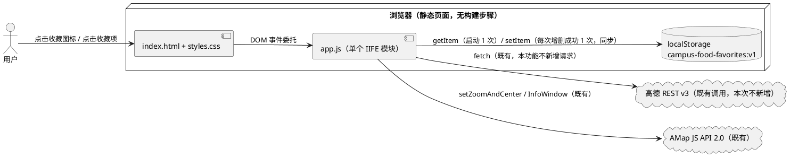
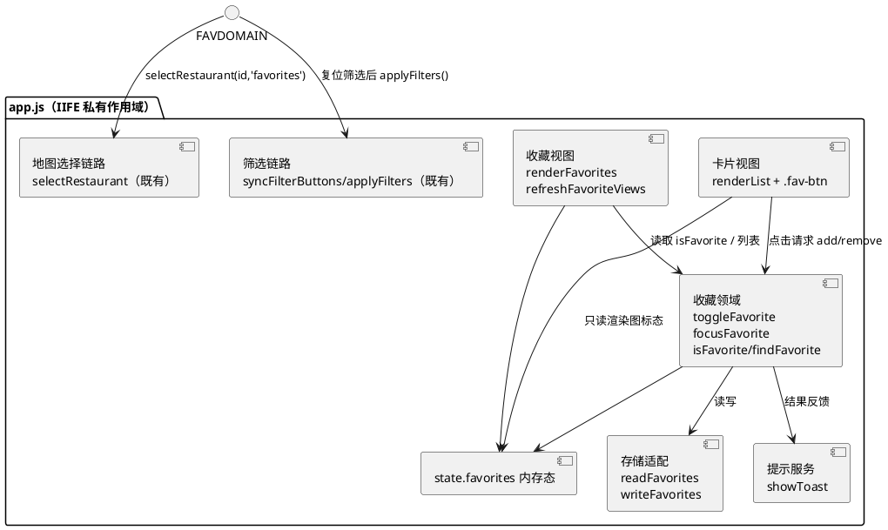
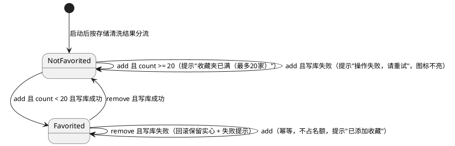
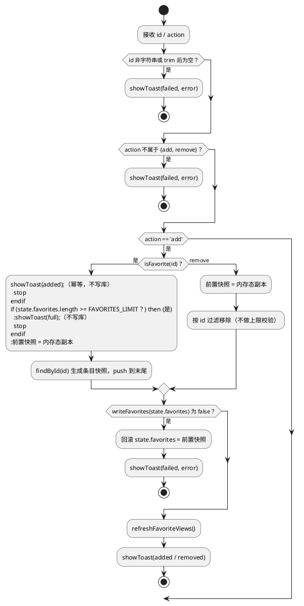
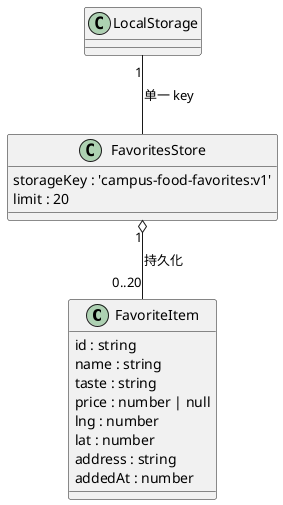
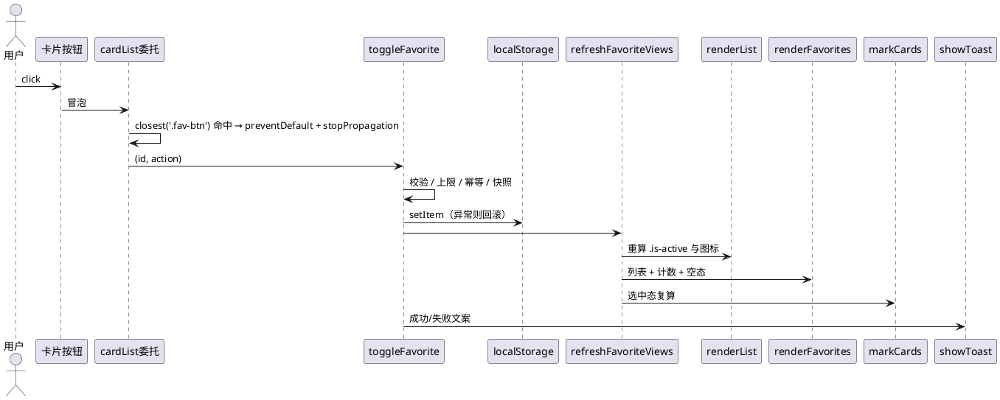
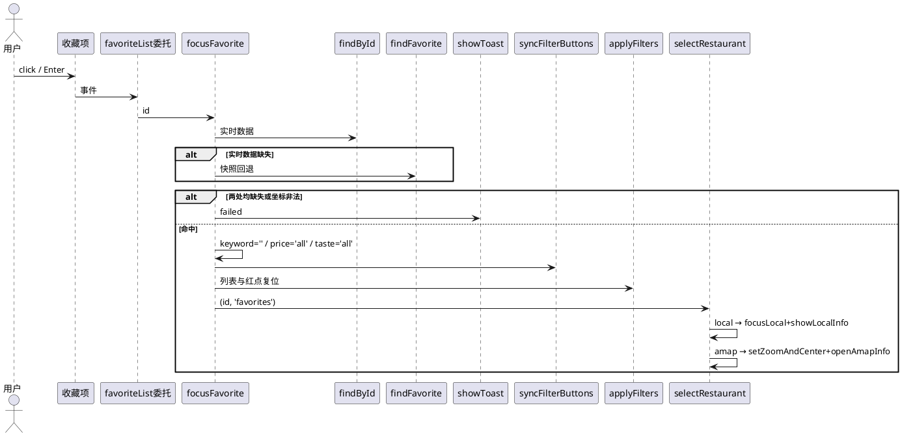

# 餐厅收藏 · 实现方案设计（design）

> 文档定位：把 `.codeartsdoer/specs/restaurant-favorites/spec.md` 转化为对既有代码的增量技术方案。
> 需求基线：`spec.md`（唯一验收依据）。任务主线：同目录 `tasks.md`（已确认），本文档**不推翻**其任务编号、文件名、存储 key `campus-food-favorites:v1`、上限 20、DOM id/class 命名与函数名。
> 技术约束：零依赖原生实现（纯 HTML/CSS/JS，沿用 `fetch` 访问高德 REST）；传统分离式 `styles.css` 手写布局（桌面左右分栏、移动堆叠）；文件名小写 kebab-case；代码标识符英文；不新增后端接口、不新增网络请求、不引入构建工具或第三方依赖。
> 改动范围：仅 `index.html`、`styles.css`、`app.js` 三个既有文件（与 `tasks.md` 第 5 行一致）。

---

# 一、需求与存量功能关系分析

## 1.1 需求功能与存量功能对比

### 1.1.1 已实现功能

| 需求功能 | 存量功能 | 代码位置 | 匹配度 |
| --- | --- | --- | --- |
| 餐厅卡片承载（名称/评分/人均/口味/地址/推荐理由） | `renderList()` 整表 `innerHTML` 渲染，卡片 `<li class="card">` 模板 | `app.js:317-344`（`card-top` 在 331-334） | 100%（只需在模板内插入收藏按钮节点） |
| 按 id 取餐厅 | `findById(id)` 线性查找 `state.restaurants` | `app.js:377-382` | 100% |
| 卡片选中态高亮 | `markCards()` 按 `data-id` 与 `state.selectedId` 比对 | `app.js:346-353` | 100% |
| 地图定位 + 弹出详情（统一入口） | `selectRestaurant(id, source)`，按 `state.mapMode` 分流 | `app.js:355-375` | 100%（收藏项点击直接复用该入口） |
| 本地示意图聚焦 | `focusLocal(item)` | `app.js:752-761` | 100% |
| 本地详情卡 | `showLocalInfo(item)` / `hideLocalInfo()` | `app.js:810-822` | 100% |
| 本地红点高亮同步 | `updateLocalMarkerState()` | `app.js:744-750` | 100% |
| 高德 InfoWindow 详情 | `openAmapInfo(item)` / `state.amapInfo` | `app.js:1157-1161`、`1014-1024` | 100% |
| 高德标记高亮 | `updateAmapMarkersActive()` | `app.js:1141-1147` | 100% |
| 列表/红点/标记重渲染 | `renderList()` / `renderLocalMarkers()` / `renderAMapMarkers()` | `app.js:317` / `702` / `1090` | 100% |
| 面板视觉规范 | `.panel`、`.panel-head`、`.result-meta`、`.panel-head h2` | `styles.css:200-222` | 100%（收藏面板直接复用，不引入新配色） |
| 品牌色与告警色变量 | `--brand` / `--brand-deep` / `--warn` 等 | `styles.css:1-15` | 100% |
| HTML 转义 | `esc(value)` | `app.js:1186-1190` | 100% |
| 高德 / 示例双模式数据 | `searchPlaces()`、`applyMockData()`、`buildMockRestaurants()` | `app.js:451-512` | 75%（数据源可复用，但收藏快照需独立于当前列表，见 1.1.2） |
| 用户提示 | `note()` / `clearNote()`（页内常驻提示条） | `app.js:258-268` | 25%（仅常驻静态条，无自动消失、无浮层、无错误态语义，不能直接承担 toast 职责） |
| 本地存储 | 无任何 `localStorage` 使用 | — | 0%（全量新增） |

### 1.1.2 需要扩展的功能

| 需求功能 | 存量功能 | 差异说明 | 扩展方向 |
| --- | --- | --- | --- |
| 点击图标不得选中卡片 | `cardList` 的 `click` 委托（`closest('.card')` → `selectRestaurant`）与 `keydown` 委托 | 收藏按钮在卡片内部，点击/回车会冒泡到卡片委托，产生"收藏即选中并跳地图"的副作用 | 在 `app.js:148-159` 两个委托的最前面用 `closest('.fav-btn')` 拦截并 `return`，不改变既有委托对卡片空白的处理 |
| 收藏项定位（可能不在当前列表） | `selectRestaurant` 直接 `findById`，取不到即静默返回 | 收藏快照的餐厅可能被关键词/价格/口味过滤掉，或被 `searchPlaces()` 整表替换后不在 `state.restaurants` 中 | 新增 `focusFavorite(id)` 薄封装：先按 id 取实时数据、回退快照 → 复位筛选与关键词并 `applyFilters()` → 调 `selectRestaurant(id, 'favorites')`；`selectRestaurant` 函数体不改 |
| 页面右侧容纳两个纵向面板 | `.layout` 为两列 grid，右列只有 `map-panel`（`index.html:83-113`） | 需要在地图下方追加面板，且地图要吃掉剩余高度 | 用 `.right-column` 包裹 `map-panel` 与新增 `favorites-panel`；`styles.css:191-198` 的两列定义保持不变 |
| 卡片头容纳第三个节点 | `.card-top` 为 `space-between` 两子项 | 直接追加第三子项会形成"名称左、评分居中、收藏右"的分散对齐 | 仅补 CSS（`.card-score { margin-left: auto }`），使评分与收藏图标靠右成组，不改 templates 中已确认的插入位置 |
| 视图一致性刷新 | 各处分别调用 `renderList()` / `markCards()` | 收藏态变化需同时刷新卡片图标与收藏面板，散落调用易漏 | 新增聚合函数 `refreshFavoriteViews()`，统一调度三处，不改变各渲染函数自身行为 |

### 1.1.3 需要新增的功能或接口

按模块分组（均为 `app.js` 内部函数、模块私有，不新增全局 API）：

1. **持久化层**
   - `readFavorites()`：入参无；出参 `FavoriteItem[]`；核心逻辑=读取 → 解析 → 清洗 → 去重 → 截断；异常静默返回空数组并清理脏数据。
   - `writeFavorites(list)`：入参数组；出参 `boolean`；序列化写入，捕获配额/隐私模式异常。
2. **收藏领域层**
   - `isFavorite(id)` / `findFavorite(id)`：按 id 在 `state.favorites` 线性查找。
   - `toggleFavorite(id, action)`：校验输入 → 上限拦截 → 快照生成 → 写库 → 回滚 → 刷新 → 提示。
   - `focusFavorite(id)`：见 1.1.2。
3. **收藏视图层**
   - `renderFavorites()`：渲染面板列表、空态、计数徽标。
   - `refreshFavoriteViews()`：聚合刷新。
4. **共享提示能力**
   - `showToast(message, type)` + `#toast` 容器 + `.toast` 样式：**收藏功能负责引入**，最近搜索功能复用（见 2.9）。
5. **结构新增**
   - `index.html`：`.right-column` 容器、`favorites-panel`、`#toast`。
   - `styles.css`：`.right-column`、`.favorites-panel`、`.favorite-list`、`.favorite-item`、`.favorites-empty`、`.fav-count`、`.fav-btn`、`.toast`。

依赖关系：视图层依赖领域层与持久化层；领域层依赖 `findById` 与 `esc`；全域依赖既有 `state` 与 `dom` 缓存；**不依赖**地图模式，`mapMode` 由既有 `selectRestaurant` 自行分流。

## 1.2 存量功能详细分析

### 1.2.1 `selectRestaurant(id, source)`（`app.js:355-375`）

- **接口契约**：入参 `id: string`、`source: 'list' | 'map'`；无返回值。找不到 item 时直接 `return`，无任何副作用。
- **业务规则**：id 变化时先 `resetRoute()`；写 `state.selectedId` → `markCards()` → 按 `mapMode` 分流。
- **扩展点**：`source` 是开放的字符串标识，仅在地图分支决定 `setCenter` 与 `setZoomAndCenter` 的差异；新增取值 `'favorites'` 会走与 `'list'` 相同的"缩放到 15 级并居中 + 打开详情"路径，属安全的扩展点。
- **约束**：必须能先通过 `findById` 命中条目，否则静默失败。这是收藏定位前必须先"让目标回到 `state.restaurants` 可见集合"的根本原因。

### 1.2.2 `applyFilters()`（`app.js:221-238`）

- **接口契约**：无入参无出参；副作用为 `renderList` + `renderMeta` + `renderLocalMarkers` +（高德模式）`renderAMapMarkers`。
- **业务规则**：若 `state.selectedId` 不在筛选结果内，会主动清空选中、重置路线、关闭详情。
- **扩展点**：复位 `state.price` / `state.taste` / `state.keyword` 并调用 `syncFilterButtons()` 后再执行 `applyFilters()`，可稳定把任意收藏项带回可见集合。
- **约束**：顺序不可颠倒——必须先复位筛选再 `selectRestaurant`，否则 `applyFilters` 的"清理不可见选中"会立即抹掉刚选中的收藏项。

### 1.2.3 `renderList()`（`app.js:317-344`）

- **接口契约**：无入参无出参；整表重建 `dom.cardList.innerHTML`。
- **业务规则**：空列表时渲染 `#emptyState`；非空时按序号 + 名称 + 评分 + 距离/人均/口味 + 地址 + 推荐理由拼串。
- **扩展点**：在 `.card-top` 内、`.card-score` 之后插入按钮节点即完成任务 3.1；模板字符串是唯一注入点。
- **约束**：全量重建会丢失 DOM 焦点；任何文本必须经 `esc()`。因此收藏态变化后刷新图标的最低成本方案是重跑 `renderList()`。

### 1.2.4 `searchPlaces()` / `applyMockData()`（`app.js:451-502`）

- **接口契约**：`searchPlaces(options)` 支持 `{ initial }`；示例模式同步返回，高德模式异步并在 `finally` 恢复搜索按钮。
- **业务规则**：两个分支都会整体替换 `state.restaurants`，并在多数分支把 `state.selectedId` 置 `null`、关闭详情。
- **约束**：收藏项不能只存 `id`——刷新后 `state.restaurants` 尚是示例/新搜索结果，必须依靠快照里的 `name/taste/price/lng/lat/address` 才能渲染面板并定位。

### 1.2.5 存储与提示现状

- 全项目无 `localStorage` 调用，无既有 key，`campus-food-favorites:v1` 无冲突；不带 `:v1` 之外的版本演进负担（key 自带版本号，便于未来迁移）。
- `note()` 是页内常驻提示条（`.notice`，`styles.css:251-260`），被"未配置 Key""真实搜索不可用"等场景使用；若改造为自动消失会破坏这些场景的持续可读性，因此**新增 toast 而不改造 note**。
---

# 二、增量设计方案

## 2.1 实现模型

### 2.1.1 上下文视图



- 唯一新增的外部依赖是浏览器内置 `localStorage`，无任何新增网络通信。
- 读写频率：启动读 1 次；每次 add/remove 写 1 次；渲染不触发 IO。

### 2.1.2 服务/组件总体架构



职责划分：
- **存储适配层**：唯一接触 `localStorage` 的位置，负责解析、清洗、序列化与异常吞掉。
- **领域层**：唯一修改 `state.favorites` 的位置，负责校验、上限、幂等与回滚。
- **视图层**：只读 `state` 与领域层判定结果，负责 DOM 生成，不写存储。
- **提示服务**：跨功能共享，收藏与最近搜索共用同一容器。

### 2.1.3 实现设计

**状态机（单条收藏）**



**主流程分支（toggleFavorite）**



**扩展点与约束**
- 地图模式无关：收藏层只调 `selectRestaurant`，`local` / `amap` 分流由既有函数完成，`tryAmap()` 失败降级后收藏定位仍可用。
- 事务边界：以"操作前深拷贝数组"为回滚点，先改内存后写库；写库失败必须整组回滚，禁止出现内存与存储不一致。
- 幂等：`add` 已存在时直接返回成功提示，不写库、不占名额。
- 视图刷新：所有变更后只经 `refreshFavoriteViews()` 一个出口，禁止在业务分支里散落调用渲染函数。

## 2.2 接口设计

### 2.2.1 总体设计

| 接口 | 分类 | 稳定性 | 调用方 | 说明 |
| --- | --- | --- | --- | --- |
| `readFavorites(): FavoriteItem[]` | 存储适配 | 稳定 | `boot` | 只读、幂等、异常静默 |
| `writeFavorites(list): boolean` | 存储适配 | 稳定 | `toggleFavorite` | 返回是否落盘成功 |
| `isFavorite(id): boolean` | 领域判定 | 稳定 | 卡片渲染、事件委托、toggle | 单一真值来源 |
| `findFavorite(id): FavoriteItem \| null` | 领域判定 | 稳定 | `focusFavorite`、渲染降级 | 快照查找 |
| `toggleFavorite(id, action): void` | 领域命令 | 稳定 | 卡片委托 | 唯一写入口 |
| `focusFavorite(id): void` | 领域命令 | 稳定 | 收藏面板委托 | 定位并弹详情 |
| `renderFavorites(): void` | 视图 | 稳定 | `boot`、刷新链路、数据源变化处 | 幂等渲染 |
| `refreshFavoriteViews(): void` | 视图聚合 | 稳定 | `toggleFavorite` | 只做调度 |
| `showToast(message, type?): void` | 共享基础设施 | 稳定（跨功能） | 收藏、最近搜索 | 单实例、自动消失 |

稳定性说明：以上均为模块私有函数（IIFE 内），外部不可见；表内"稳定"指跨功能复用时不得更改语义。

### 2.2.2 接口清单

**A. 存储适配**

```text
readFavorites(): FavoriteItem[]
 前置：无（可在 DOM 就绪前调用）
 后置：返回长度 <= 20 的数组；不修改 DOM；异常时返回 []
 异常：JSON 解析失败 / 非数组 / 元素非法 → 静默 removeItem 并返回 []
writeFavorites(list: FavoriteItem[]): boolean
 前置：list 为数组且 id 唯一
 后置：true=已持久化；false=未持久化且不抛出
 异常：QuotaExceededError / 隐私模式禁用 / SecurityError → 返回 false
```

**B. 领域判定**

```text
isFavorite(id: string): boolean
findFavorite(id: string): FavoriteItem | null
 前置：id 可为任意值，内部按严格等价比较
 后置：线性查找，不改变状态
```

**C. 领域命令**

```text
toggleFavorite(id: string, action: 'add' | 'remove'): void
 前置：state.favorites 已初始化（boot 装载完成）
 后置：成功后 state.favorites 与 localStorage 一致，视图已刷新，已给提示
 异常映射：见 2.2.3
focusFavorite(id: string): void
 前置：state.restaurants / state.favorites 至少一方含该 id
 后置：筛选与关键词复位 → 列表/红点刷新 → 地图定位 + 详情打开
 失败：两处均取不到或坐标非法 → showToast(failed, 'error')，不改选中态
```

**D. 视图**

```text
renderFavorites(): void
 前置：dom.favoriteList / dom.favoritesEmpty / dom.favCount 已缓存
 后置：列表、空态、计数三者与 state.favorites 一致；所有文本经 esc()
refreshFavoriteViews(): void
 后置：等价于 renderList() + renderFavorites() + markCards()
showToast(message: string, type?: 'info' | 'error'): void
 后置：同一时刻仅一条可见；普通 2000ms、错误 2600ms 后自动隐藏
```

### 2.2.3 异常与文案映射

| 触发条件 | 数据变化 | 用户可见反馈 |
| --- | --- | --- |
| id 非法 / action 非法 | 无 | `操作失败，请重试`（error，2600ms） |
| add 但已达 20 家 | 无 | `收藏夹已满（最多20家）`（error） |
| add 但已收藏 | 无（幂等） | `已添加收藏` |
| add 成功 | 追加 1 条 | `已添加收藏` |
| remove 成功 | 移除 1 条 | `已取消收藏` |
| 写库失败（任一分支） | 回滚到操作前 | `操作失败，请重试` |
| 读取失败 / 脏数据 | 视为空收藏 | 无提示（静默） |

文案常量集中为 `FAVORITE_TOAST`（`added` / `removed` / `failed` / `full`），逐字符与 spec 一致（含中文逗号与全角括号）。上限数值唯一来源为 `FAVORITES_LIMIT = 20`，文案中的 `20` 仅出现在字符串字面量内。

## 2.3 数据模型

### 2.3.1 设计目标

1. 支撑"刷新后收藏仍在、面板仍可渲染、点击仍可定位"，因此必须保存**展示与定位所需的快照**，不能只存 id。
2. 顺序可预测：面板顺序 = 添加顺序，与 `addedAt` 无关（`addedAt` 仅调试字段），避免时间相同导致的不稳定排序。
3. 与实时数据一致性：同 id 时**渲染与定位优先使用 `state.restaurants` 的实时数据**，快照仅作降级。
4. 容量目标：<= 20 条，单条 < 300 字节，总量 < 8KB，远低于常见配额；不做分片与压缩。
5. 与存量数据兼容：key 自带 `:v1`，无历史数据需要迁移。

### 2.3.2 模型实现



存储契约：

| 项 | 约定 |
| --- | --- |
| key | `campus-food-favorites:v1` |
| 值格式 | JSON 数组字符串，如 `[{"id":"mock-01",...}]` |
| 元素结构 | `{ id, name, taste, price, lng, lat, address, addedAt }`，缺字段允许（渲染降级） |
| 顺序语义 | 索引 0 = 最早收藏，末尾 = 最新收藏；渲染按数组顺序 |
| 唯一性 | `id` 唯一（严格字符串比较） |
| 上限 | `FAVORITES_LIMIT = 20`，写入路径与读取路径双重截断 |
| 写入时机 | 仅在 add / remove 成功后，整组覆盖写入 |
| 读清洗 | 丢弃非对象、`id` 非非空字符串项；按 id 保留首次出现；截断 20；结构非法整体返回 `[]` 并 `removeItem` |
| 字段来源 | 新增时由 `findById(id)` 生成；`price` 允许 `null`；`name` 为空时渲染回退"未命名餐厅" |

生命周期：
- 创建：`add` 成功 → 追加末尾。
- 稳定：搜索/筛选/排序/地图切换均不修改数组。
- 删除：`remove` 成功 → 过滤移除；不提供单条以外的批量删除能力（spec 无要求）。
- 清空：spec 未定义"清空收藏"，本期不实现，避免超出范围。

## 2.4 UI 结构与 DOM 约定

### 2.4.1 页面结构（`index.html`）

```text
<main class="layout">
  <section class="panel list-panel">        ← 既有，不改
  <div class="right-column">                 ← 新增
    <section class="panel map-panel">        ← 既有整体平移，内部零改动
    <section class="panel favorites-panel">  ← 新增
      <div class="panel-head">
        <h2 id="favTitle">我的收藏</h2>
        <span class="fav-count" id="favCount">0/20</span>
      <ul class="favorite-list" id="favoriteList" aria-live="polite"></ul>
      <div class="favorites-empty" id="favoritesEmpty">
    </section>
  </div>
</main>
<!-- </body> 之前 -->
<div class="toast" id="toast" role="status" aria-live="polite" aria-atomic="true" hidden></div>
```

### 2.4.2 DOM 契约

| 标识 | 元素 | 职责 | 状态 / 属性 |
| --- | --- | --- | --- |
| `#toast` | `div.toast` | 全局一次性提示 | `hidden`（默认）/ `.is-visible` / `.is-error`；`role=status`、`aria-live=polite`、`aria-atomic=true` |
| `.right-column` | `div` | 右列纵向容器 | 桌面 `flex column`；`max-width:900px` 下 `display: contents` |
| `#favTitle` | `h2` | 面板标题 | 被 `aria-labelledby` 引用 |
| `#favCount` | `span.fav-count` | 计数 `n/20` | `.is-full` 满额强调 |
| `#favoriteList` | `ul.favorite-list` | 收藏列表 | `aria-live=polite`；空时清空 |
| `.favorite-item` | `li` | 单条收藏 | `data-id`、`tabindex="0"`、`role="button"`、`aria-label`（含"查看并在地图定位"） |
| `#favoritesEmpty` | `div.favorites-empty` | 空态 | 主文案"还没有收藏的餐厅"、副文案"点击卡片上的 ♡ 收藏喜欢的店"；有收藏时 `hidden` |
| `.fav-btn` | `button` | 卡片收藏按钮 | `type="button"`、`data-id`、`aria-pressed="true|false"`、`aria-label="取消收藏|收藏"`；已收藏追加 `.is-active`；图标实心 `♥` / 空心 `♡` |

约定：`data-id` 一律经 `esc()` 输出；`aria-pressed` 与 `.is-active` 必须同步；收藏按钮不接管键盘事件，交由原生 button 处理。

### 2.4.3 CSS 落点

| 新增样式 | 落点锚点 | 要点 |
| --- | --- | --- |
| `.fav-btn` 系列 | `styles.css:308` 之后（`.card-score` 规则后） | 透明底无边框、15px、热区 >= 28×28、`.is-active` 用 `--brand`、`:focus-visible` 保留焦点环 |
| `.card-score { margin-left: auto }` | 随 `.fav-btn` 同区块 | 让评分与收藏靠右成组，修补 `.card-top` 三子项分散 |
| `.right-column` / `.favorites-panel` / `.favorite-list` / `.favorite-item` / `.favorites-empty` / `.fav-count` | `styles.css:198` 之后（`.layout` 规则后、`.panel` 前） | 右列 `flex: 1 1 auto`、`min-height: 0`；面板 `max-height: 260px`；列表 `overflow-y: auto` |
| `.toast` / `.toast.is-visible` / `.toast.is-error` | `styles.css:830` 之后（文件末尾新增区） | `position: fixed` 底部居中、`z-index` 高于 `.map-loading`(45) 取 60、`opacity/transform` 过渡、错误态用 `--warn` 系列 |
| 移动端右列与面板 | `styles.css:596-621` 既有 `@media (max-width: 900px)` 块内 | 见下方顺序修正 |
| 窄屏细节 | `styles.css:623-629` 既有 `@media (max-width: 420px)` 块内 | 收藏项内边距与卡片一致、计数降一档、toast 左右安全边距 >= 12px |

**移动端顺序修正（重要）**：按 tasks 7.1 采用 `.right-column { display: contents; }` 后，右列子项展开为 `.layout` 的 flex 项，DOM 顺序为 `list → map → favorites`；而 `.layout` 是 `column-reverse`（`styles.css:605-610`），视觉顺序会变成 `favorites → map → list`，与 tasks 7.1 期望的"地图 → 我的收藏 → 推荐结果"相反。因此在不推翻 `display: contents` 决策的前提下补一条 `order` 规则：

```
.right-column .map-panel { order: 2; height: 296px; }
.favorites-panel { order: 1; max-height: 220px; }
/* list-panel 默认 order: 0，位于 column-reverse 主轴的起点（最底部） */
```

主轴（自底向上）顺序为 `list(0) → favorites(1) → map(2)`，视觉自上而下即为 `map → favorites → list`，满足 tasks 7.1 的验收描述。

## 2.5 事件与状态同步链路

### 2.5.1 事件表

| 事件源 | 监听位置（锚点） | 处理函数 | 状态变更 | 视图刷新 |
| --- | --- | --- | --- | --- |
| 卡片收藏按钮 `click` | `app.js:148-151` 委托**最前面**插入拦截 | `toggleFavorite(id, action)` | `state.favorites` | `refreshFavoriteViews()` + toast |
| 卡片 `keydown`（Enter/Space） | `app.js:153-159`，开头追加 `.fav-btn` 排除 | 无（交原生按钮） | 无 | 无 |
| 收藏项 `click` | `app.js:114` `bindEvents` 内新增 `dom.favoriteList` 监听 | `focusFavorite(id)` | `keyword/price/taste/selectedId` | `syncFilterButtons` → `applyFilters` → `selectRestaurant` |
| 收藏项 `keydown` | 同上（Enter/Space） | `focusFavorite(id)` | 同上 | 同上 |
| 启动 | `app.js:74-75` 之间 | `state.favorites = readFavorites()`；随后 `renderFavorites()` | `state.favorites` | 卡片首帧图标正确 |
| 数据源变化 | `app.js:479`（`searchPlaces` 成功分支末尾）、`app.js:501`（`applyMockData` 末尾） | `renderFavorites()` 追加调用 | 无 | 面板按实时数据重算展示字段 |

### 2.5.2 收藏切换后的同步链路



### 2.5.3 收藏项定位链路



### 2.5.4 视图刷新矩阵

| 变更来源 | `renderList` | `renderFavorites` | `markCards` | 红点/标记 |
| --- | --- | --- | --- | --- |
| add / remove 成功 | 是（图标态） | 是 | 是 | 不改（集合仍由筛选结果决定） |
| 写库失败回滚 | 是（图标回退） | 是 | 是 | 不改 |
| 搜索 / 筛选 / 排序 | 既有逻辑 | 由数据源变化处追加调用 | 既有逻辑 | 既有逻辑 |
| 收藏项定位 | 经 `applyFilters` 触发 | 否 | `selectRestaurant` 内 | 经 `applyFilters` / `selectRestaurant` 触发 |

## 2.6 文件改动清单

| 文件 | 位置锚点 | 改动类型 | 内容 |
| --- | --- | --- | --- |
| `app.js` | `11` 行后（`AMAP_READY_TIMEOUT` 之后） | 新增常量 | `FAVORITES_STORAGE_KEY`、`FAVORITES_LIMIT`、`FAVORITE_TOAST`、`toastTimer` |
| `app.js` | `27` 行后（`selectedId` 之后） | 新增状态 | `favorites: []` |
| `app.js` | `74-75` 之间 | 新增调用 | 装载收藏 + 首次渲染面板 |
| `app.js` | `86-112` `cacheDom` 末尾 | 新增缓存 | `toast`、`favoriteList`、`favoritesEmpty`、`favCount` |
| `app.js` | `114-196` `bindEvents` | 新增监听 + 拦截 | 卡片委托前置拦截、`favoriteList` click/keydown |
| `app.js` | `148-159` | 修改 | `closest('.fav-btn')` 命中即 return；keydown 排除按钮 |
| `app.js` | `317-344` `renderList` 模板 | 修改 | `.card-top` 内 `.card-score` 后插入 `.fav-btn` |
| `app.js` | `377-382` `findById` 附近 | 新增函数 | `readFavorites` / `writeFavorites` / `isFavorite` / `findFavorite` |
| `app.js` | `355-375` `selectRestaurant` 之后 | 新增函数 | `focusFavorite` / `toggleFavorite` / `showToast` / `renderFavorites` / `refreshFavoriteViews` |
| `app.js` | `479`、`501` | 新增调用 | 数据源变化后 `renderFavorites()` |
| `index.html` | `83-113` | 结构调整 | `map-panel` 包入 `.right-column`，其后新增 `favorites-panel` |
| `index.html` | `121` 之前（三个 `<script>` 前） | 新增节点 | `#toast` |
| `styles.css` | `308` 之后 | 新增样式 | `.fav-btn` 系列 + `.card-score` 靠右修正 |
| `styles.css` | `198` 之后 | 新增样式 | 右列与收藏面板布局 |
| `styles.css` | `830` 之后 | 新增样式 | `.toast` 系列 |
| `styles.css` | `596-621`、`623-629` | 新增规则 | 移动端 `order` / 高度 / 间距 |

未改动：`mock-data.js`、`config.local.js`、`config.example.js`；不新增文件、不改构建配置。

## 2.7 边界与异常场景

| 场景 | 设计处置 |
| --- | --- |
| 存储被禁用 / 隐私模式 | `readFavorites` 返回 `[]` 且不打断 `boot`；`writeFavorites` 返回 `false` → 回滚内存态 + `操作失败，请重试`，无未捕获异常 |
| 配额溢出（QuotaExceededError） | 同上，走回滚分支 |
| 脏数据：`not-json` / 非数组 / 元素非对象 / `id` 非字符串或空串 | 读取清洗后按合法项处理；整体不合法则 `removeItem` 并返回 `[]`；页面正常渲染空态 |
| 重复 `id` | 读取保留首次出现；写入前以 `id` 断言唯一 |
| 超过 20 家 | 第 21 家被拦截，提示 `收藏夹已满（最多20家）`，计数停在 `20/20`，不写库 |
| 重复点击同一家 `add` | 幂等，条数不变，提示 `已添加收藏` |
| 快照缺字段 / `price` 为 `null` | 面板价格显示 `—`；`name` 为空回退 `未命名餐厅` |
| 快照坐标非法（NaN / 缺失） | `focusFavorite` 判定后提示 `操作失败，请重试`，不移动地图 |
| 收藏目标被筛选过滤 | `focusFavorite` 先复位 `keyword/price/taste` 并 `applyFilters`，再 `selectRestaurant` |
| 高德模式 | `selectRestaurant` 走 `setZoomAndCenter` + InfoWindow；`tryAmap` 失败降级 `local` 后收藏定位仍可用 |
| 示例数据模式 | 快照由 `buildMockRestaurants` 产出的 `mock-xx` 生成，刷新后仍可定位 |
| 连续快速点击 | 全链路同步执行，状态即时一致；`showToast` 每次 `clearTimeout` 重计时，仅最后一条可见 |
| 面板超长 | 桌面 `max-height: 260px`、移动 `220px`，仅面板内部滚动，不挤压地图 |
| 其他标签页修改存储 | 不监听 `storage` 事件（超出 spec 范围），页内以内存态为准，刷新后与存储对齐 |

## 2.8 验收对照（对应 `spec.md` 6 条）

| # | spec 验收标准 | 设计落点 | 验证方式 |
| --- | --- | --- | --- |
| 1 | 每个餐厅卡片上显示收藏图标（空心/实心） | `renderList` 模板插入 `.fav-btn`（`app.js:331-334` 区），`isFavorite` 决定 `♥/♡` 与 `.is-active` | 加载后所有卡片含 `.fav-btn`；搜索/筛选/排序重渲染后图标态一致 |
| 2 | 点击图标可正常添加/取消收藏 | 卡片委托前置拦截 → `toggleFavorite` → `refreshFavoriteViews` + toast | 单次点击切换图标态并出现对应文案；点击图标不触发卡片选中、地图不跳转 |
| 3 | 刷新页面后收藏状态保持 | `FAVORITES_STORAGE_KEY` 持久化 + `boot` 装载（`app.js:74-75`） | F5 后图标/列表/计数三者一致；存储条目数与计数相同 |
| 4 | 收藏超过 20 家时提示上限 | `FAVORITES_LIMIT` 拦截 + `FAVORITE_TOAST.full` | 第 21 家被拦截、计数不增长；删除一家后可再次收藏 |
| 5 | "我的收藏"面板正确显示列表 | `right-column` + `favorites-panel` + `renderFavorites`（按数组顺序、`n/20`、空态） | 面板在地图下方；字段与卡片一致；超出高度内部滚动 |
| 6 | 点击收藏列表餐厅，地图定位并弹出详情 | `favoriteList` 委托 → `focusFavorite` → 复位筛选 → `selectRestaurant(id,'favorites')` | 地图平移到该坐标、红点高亮、详情卡出现；筛选状态下点击会自动复位 |

补充验收（来自 spec 输出段，非 checkbox 但需保证）：收藏成功 `已添加收藏`、取消 `已取消收藏`、失败 `操作失败，请重试`，三处文案逐字符一致；同一餐厅不可重复收藏（幂等）。

## 2.9 与"最近搜索"功能的协作边界

- **存储隔离**：收藏使用 `campus-food-favorites:v1`；最近搜索使用 `campus-food-recent-searches:v1`。两者读写函数互不调用，任一 key 损坏不影响另一方。
- **共享 toast**：`#toast` 单实例、`showToast` 单实现，由本功能引入；最近搜索仅调用，不重复定义。合并代码时若两处都新增，保留一处即可（函数名、id、class 契约一致）。
- **`state` 字段**：`favorites: []` 与 `recentSearches: []` 相邻声明，互不依赖。
- **事件边界**：本功能只操作 `cardList` / `favoriteList`；最近搜索操作 `searchForm` / `recentSearch`，无覆盖。
- **CSS 命名空间**：`.fav-*`、`.favorites-*`、`.toast`；最近搜索使用 `.recent-*`，无冲突。